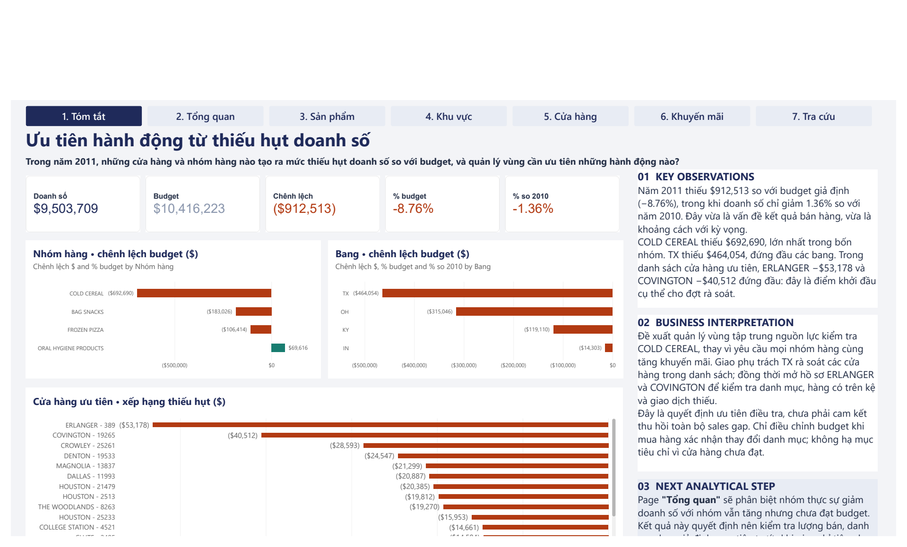
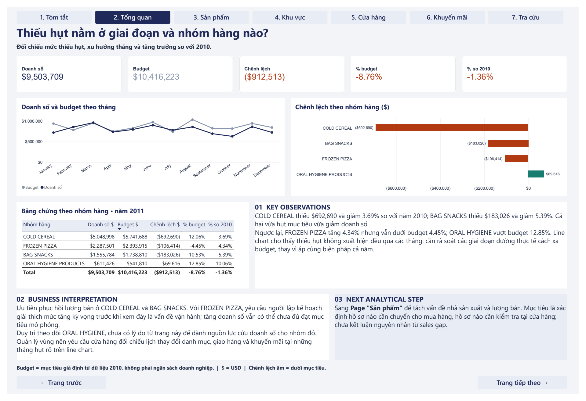
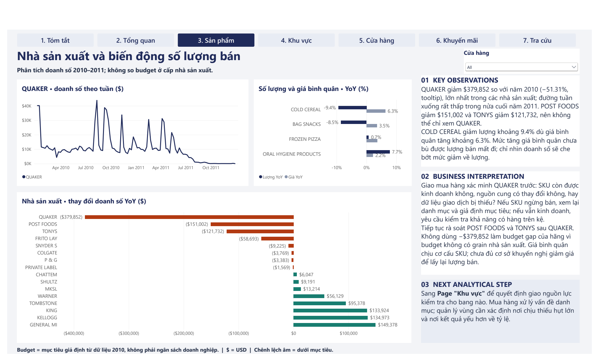
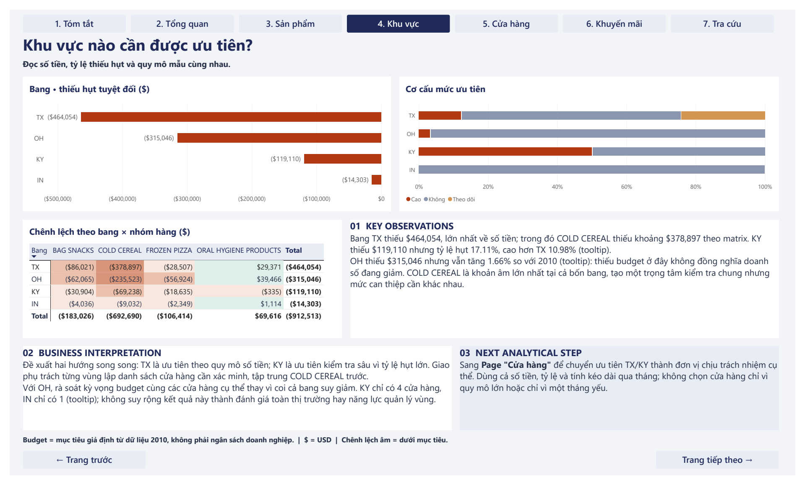
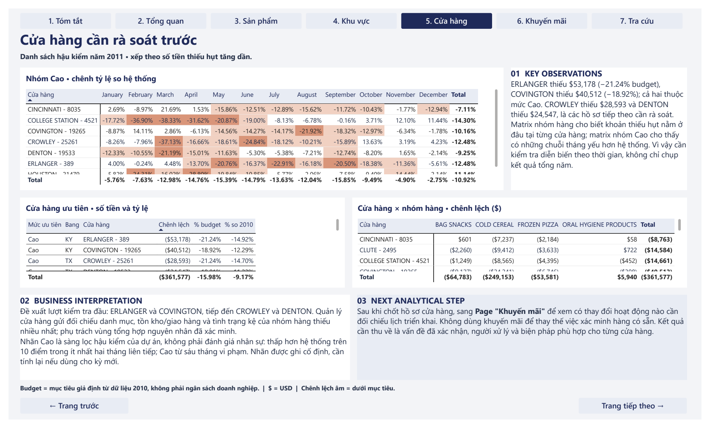
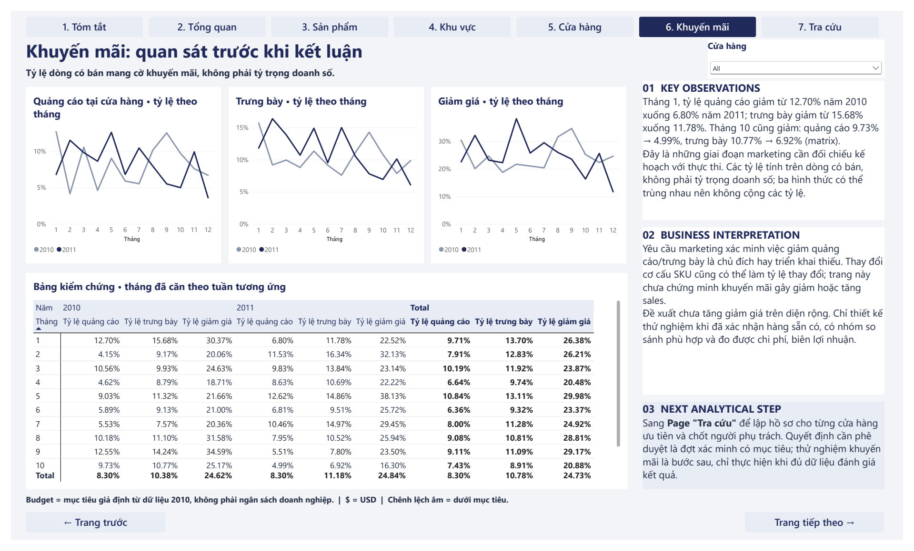
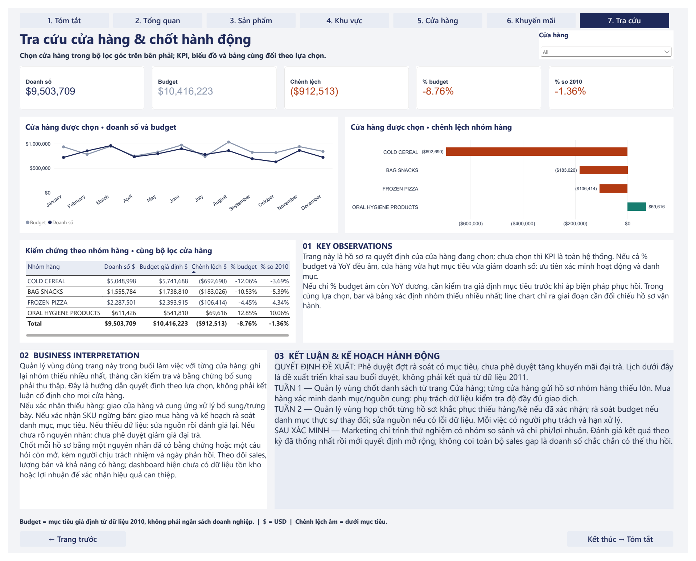

**English** | [Tiếng Việt](README.vi.md)

# Retail Sales Shortfall Analysis: Power BI Dashboard

A portfolio project that uses Excel, Power Query, DAX and Power BI to analyse 2011 retail sales against a **simulated budget**, and to help a regional manager decide where to investigate first.



## Contents

1. [Project Overview](#1-project-overview)
2. [Business Problem and Question](#2-business-problem-and-question)
3. [Dataset](#3-dataset)
4. [Analytical Workflow](#4-analytical-workflow)
5. [Budget Methodology](#5-budget-methodology)
6. [Dashboard Overview](#6-dashboard-overview)
7. [Key Findings](#7-key-findings)
8. [Business Recommendations](#8-business-recommendations)
9. [Technical Implementation](#9-technical-implementation)
10. [Repository Structure](#10-repository-structure)
11. [How to Use](#11-how-to-use)
12. [Assumptions and Limitations](#12-assumptions-and-limitations)
13. [References](#13-references)

## 1. Project Overview

| | |
|---|---|
| **Type** | Personal portfolio project with a constructed business scenario |
| **Data** | dunnhumby, Breakfast at the Frat: 524,950 weekly sales rows, 2009 to early 2012 |
| **Purpose** | Find where 2011 sales fell short of target and which issues to investigate first |
| **Tools** | Excel, Power Query, Power BI, DAX |
| **Dashboard language** | Vietnamese. This README explains each page in English |

## 2. Business Problem and Question

A regional manager needs to know where to focus a 2011 sales review. Sales are slightly below 2010, but the gap against target is much larger, so it matters whether each area is really declining or only missing an expectation.

**Business question:**

> In 2011, which stores and product categories created the sales shortfall against budget, and which actions should the regional manager prioritise?

**Decisions supported:**

- Which categories, states and stores to review first.
- Which issues go to buying, stores or marketing.
- Whether a wide promotion increase is justified yet.

## 3. Dataset

| Item | Detail |
|---|---|
| **Source** | [dunnhumby Source Files](https://www.dunnhumby.com/source-files/) |
| **Grain** | Product × store × week, only where a sale exists |
| **Period** | 156 weeks ending 14 January 2009 to 4 January 2012 |
| **Coverage** | 77 stores in 4 US states, 4 categories, 55 products with sales |
| **Size** | 524,950 transaction rows; $27.93M spend; 10.29M units |

The original workbook has a glossary, store lookup, product lookup and transaction sheet. Preparation resolves 2 duplicate store IDs, removes one incomplete store column and adds analysis columns. Transaction rows and totals are unchanged: rows, spend and units reconcile across the raw file, the prepared Excel file and the Power BI model.

`VISITS` and `HHS` cannot be added across products or weeks, so no measure uses them.

An unmodified copy of the source workbook is in [`data/raw/`](data/raw/), with attribution in [References](#13-references).

## 4. Analytical Workflow

```text
Raw Data → Data Cleaning → Budget Construction → Data Modeling → DAX → Power BI Dashboard → Business Insights
```

1. **Raw data:** Profile sheets, grain, blanks, duplicates and unusual values.
2. **Cleaning:** Clean the data in Excel Power Query and reconcile totals.
3. **Budget:** Build a simulated weekly target in Excel Power Query.
4. **Modeling:** Import the queries into Power BI, add helper columns, and build a star-style model with two fact tables.
5. **DAX:** 20 measures for gap, year-on-year change, store comparison and promotion rates.
6. **Dashboard:** 7 pages, each with observations, interpretation and next step.

Full detail: [Project Methodology](docs/Project_Methodology.md).

## 5. Budget Methodology

**The budget is simulated. It is not an actual dunnhumby or company budget.** The dataset has no target, so one was built to make the shortfall question answerable.

```text
Budget (2011 week, store, category)
  = Sales in the matching 2010 week, 364 days earlier × (1 + category growth)

Category growth = 2010 sales / 2009 sales − 1, over 51 matching weeks, excluding store 387
```

| Category | Growth used |
|---|---:|
| BAG SNACKS | +5.74% |
| COLD CEREAL | +9.52% |
| FROZEN PIZZA | +9.20% |
| ORAL HYGIENE PRODUCTS | −2.47% |

Rates are rounded for display. The calculation uses unrounded values, listed in [Budget Methodology](docs/Budget_Methodology.md#growth-rate-g).

**Why 2010:** It is the latest complete period before 2011, with all 52 weeks and all 16,016 store × category × week combinations. It also preserves each store's weekly pattern. Product-level rows are not complete, because rows exist only where a sale exists.

**Why 51 and 52 weeks:** Growth uses 51 weeks because the file has only 51 weeks in 2009, so the week ending 6 January 2010 has no match. Evaluation uses 52 weeks because every 2011 week has a matching 2010 week.

**Store 387:** It is missing 25 weeks of 2009, which would inflate growth, so it is excluded from the growth calculation only. It stays in the 2010 baseline, the 2011 budget and the 2011 evaluation.

**Missing combinations:** No values are filled or estimated. Of 101 missing store × category × week combinations, 100 are store 387 in 2009, handled by the exclusion above. The other is store 8035 in one week of 2011, which counts as a $12.57 shortfall. None are in the 2010 baseline.

**Key assumptions:** 2009 to 2010 growth continues into 2011; each store in a category gets the same growth rate; unusual 2010 weeks carry forward.

**Why it matters:** The total gap is −$912,513 under this method. With no growth assumed, it would be −$130,990. Budget results should be read with the year-on-year change.

Budget was rebuilt separately and matches the model: 16,016 rows and $10,416,222.58.

Full detail, example and validation: [Budget Methodology](docs/Budget_Methodology.md).

## 6. Dashboard Overview

| Page | Purpose | Main content |
|---|---|---|
| **1. Summary** (Tóm tắt) | Answer the main question | KPIs; gap by category and state; ranked priority stores |
| **2. Overview** (Tổng Quan) | Separate real decline from missing the target | Monthly sales and budget; category evidence table |
| **3. Product** (Sản phẩm) | Find manufacturer and volume changes | QUAKER weekly sales; volume and price change; change by manufacturer |
| **4. Region** (Khu Vực) | Prioritise states | Gap by state; priority mix; state × category matrix |
| **5. Store** (Cửa hàng) | Choose stores to review | Monthly gap against all stores; priority list; store × category |
| **6. Promotion** (Khuyến mãi) | Describe promotion activity without implying cause | Feature, display and discount rates by month |
| **7. Store Lookup** (Tra cứu) | Build a store file and close with an action plan | Store slicer; KPIs; charts; action plan |

<details>
<summary>View all pages</summary>

### Overview


### Product


### Region


### Store


### Promotion


### Store Lookup


</details>

Screenshots come from the [exported PDF](dashboard/Project3_Final_Dashboard.pdf) of the final dashboard.

## 7. Key Findings

All figures below were checked against the Power BI model. Gaps are against the simulated budget.

1. **The gap is larger than the decline.** 2011 sales were $9,503,709: $912,513 under budget (−8.76%), but only 1.36% below 2010.
2. **COLD CEREAL has the largest gap** at −$692,690 (−12.06%), and it fell 3.69% against 2010. BAG SNACKS also missed budget and declined.
3. **Missing budget does not always mean decline.** FROZEN PIZZA grew 4.34% but was 4.45% under budget.
4. **QUAKER fell most among manufacturers:** −$379,852 (−51.31%), with weekly sales close to zero in late 2011. The data does not show why.
5. **Volume fell in COLD CEREAL** by about 9.4%, while average price rose about 6.3%. Average price is affected by product mix.
6. **Size and severity differ by state.** TX has the largest dollar gap (−$464,054). KY has the highest rate (−17.11%), from just 4 stores. OH missed budget by $315,046 but grew 1.66%.
7. **18 of 77 stores met the project's screening rule,** together −$361,577. ERLANGER (−$53,178) and COVINGTON (−$40,512) are the largest.
8. **Promotion activity changed in some months.** The feature rate fell from 12.70% to 6.80% in January and from 9.73% to 4.99% in October. This is descriptive, and does not show that promotions changed sales.

## 8. Business Recommendations

These are proposed actions based on the findings. They were not implemented, so no business impact was measured.

| Owner | Proposed action | Based on |
|---|---|---|
| **Buying** | Confirm whether QUAKER items are still listed, whether supply changed, or whether data is missing. Review the target only if a range change is confirmed | Finding 4 |
| **Regional manager** | Approve a targeted review, starting with COLD CEREAL. TX by dollar size, KY for depth | Findings 2, 6 |
| **Store managers** | Start with ERLANGER and COVINGTON, then CROWLEY and DENTON. Check range, stock, delivery and shelf condition | Finding 7 |
| **Planning** | Review growth expectations where sales grew but missed budget, such as FROZEN PIZZA and OH | Findings 3, 6 |
| **Marketing** | Check whether lower feature and display rates were planned. Do not start wide discounts yet; test later with a comparison group and cost and margin data | Finding 8 |

## 9. Technical Implementation

| Tool | Actual role |
|---|---|
| **Excel and Power Query** | Data profiling, cleaning, joins, grouping, the growth calculation, the simulated budget and dimension tables |
| **Power BI Power Query** | Imported the Excel queries and added `Is_Discount`, `Thang_So_Sanh` and `Muc_Uu_Tien` |
| **Power BI** | Data model, 7-page dashboard, navigation and slicers |
| **DAX** | 20 measures, using `SUM`, `AVERAGE`, `DIVIDE`, `CALCULATE` and `ALL` |

**Model:**

```text
Dim_Category → Dim_Product → Fact_Transactions ← Dim_Store, Dim_Date
Dim_Category, Dim_Store, Dim_Date → Budget
```

Details: [DAX Measures](docs/DAX_Measures.md).

## 10. Repository Structure

```text
.
├── README.md                     English README
├── README.vi.md                  Vietnamese README
├── .gitignore
├── assets/screenshots/           7 dashboard page images
├── dashboard/
│   ├── Project3_Final_Dashboard.pbix
│   └── Project3_Final_Dashboard.pdf
├── data/raw/
│   └── dunnhumby - Breakfast at the Frat.xlsx
├── docs/
│   ├── Project_Methodology.md
│   ├── Budget_Methodology.md
│   ├── DAX_Measures.md
│   └── Power_Query_M.md
```

## 11. How to Use

**To review the results:** Open the [PDF](dashboard/Project3_Final_Dashboard.pdf) or the screenshots above. No software is needed.

**To explore the dashboard:** Install Power BI Desktop for Windows and open [`dashboard/Project3_Final_Dashboard.pbix`](dashboard/Project3_Final_Dashboard.pbix). The file was checked on version 2.159. The data is already stored in the file, so no refresh is needed.

**To refresh the data:**

1. In Power BI Desktop, go to **Home → Transform data → Data source settings**.
2. Select the workbook source, choose **Change Source**, and point it to `data/raw/dunnhumby - Breakfast at the Frat.xlsx` in your copy of this repository.
3. Select **Close**, then **Refresh**. A refresh test took about a minute.

The source list may shorten a long path with `...`. To see the full path, select **Change Source** again.

## 12. Assumptions and Limitations

- **The budget is simulated.** A shortfall is against a project assumption, not a real target.
- **The scenario is constructed.** There was no real client or stakeholder.
- **The data is historical and sampled.** "System" on the dashboard means these 77 stores, not a whole chain.
- **Promotion results are descriptive.** Formats overlap with discounts, and rates are shares of sold rows, not revenue. No causal effect is claimed.
- **Rows exist only where sales exist.** Out-of-stock and no-demand cannot be told apart.
- **No cost, margin, inventory or competitor data.** Causes and profitability cannot be determined.
- **Priority rules are project assumptions.** The 10-point, 2-month and 6-month rules were set after seeing 2011 results, are hard-coded, and change somewhat if QUAKER is excluded.
- **Small samples.** KY has 4 stores and IN has 1.
- **Commentary is static.** It describes the unfiltered view and does not change with slicers.

## 13. References

- [dunnhumby Source Files](https://www.dunnhumby.com/source-files/): Breakfast at the Frat, the source of the data. All rights in the data remain with dunnhumby. See the [dunnhumby Terms and Conditions](https://www.dunnhumby.com/terms-and-conditions/). The data is included unmodified for non-commercial portfolio purposes, and is not covered by any license for this repository. It will be removed at dunnhumby's request.
- [Microsoft Power BI documentation](https://learn.microsoft.com/power-bi/)
