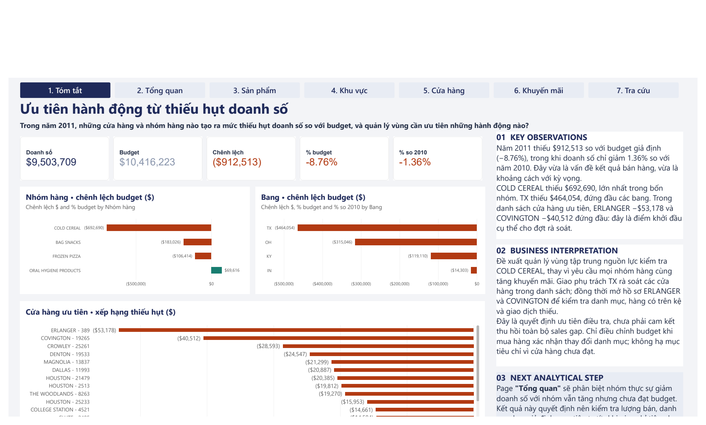
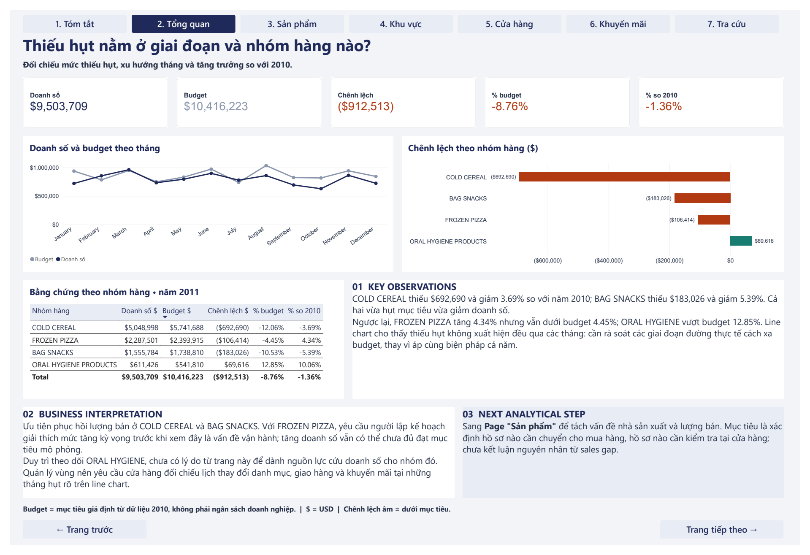
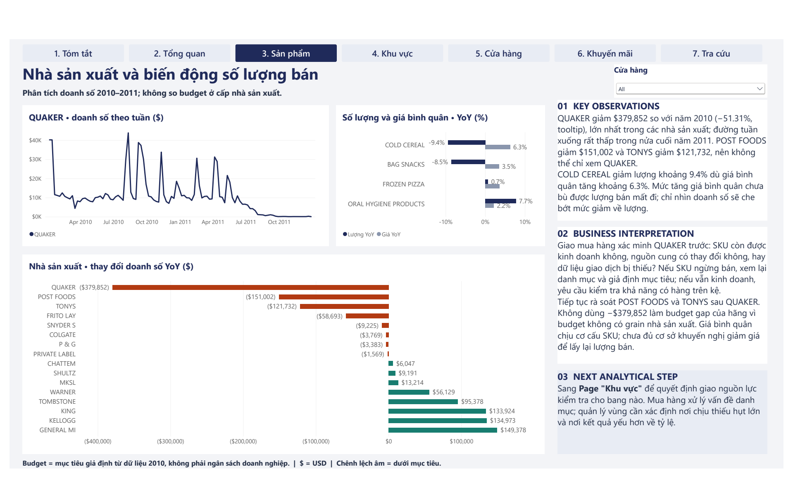
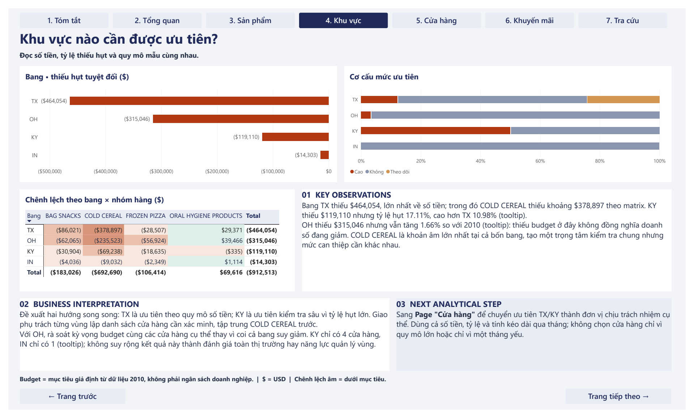
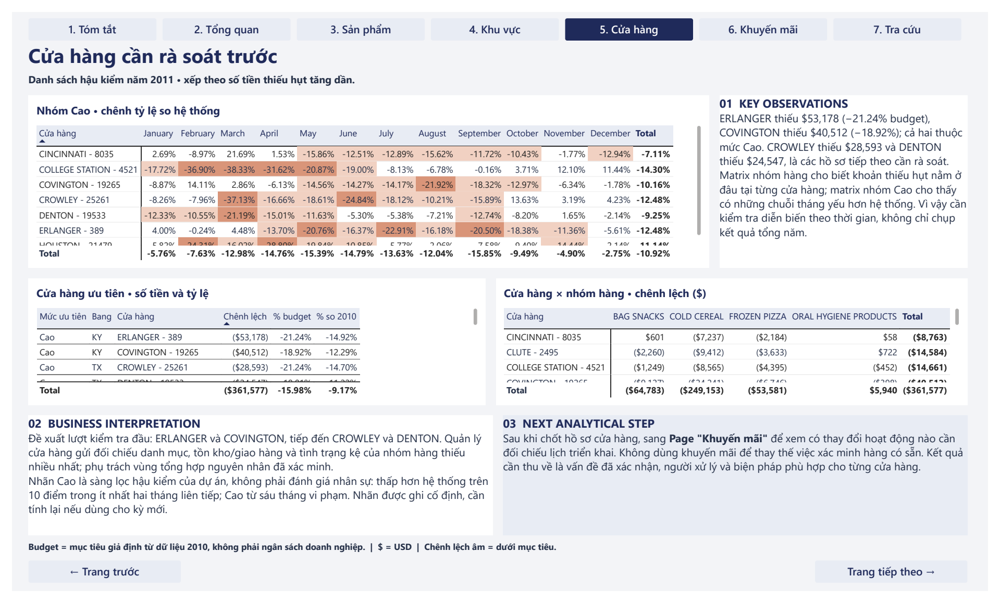
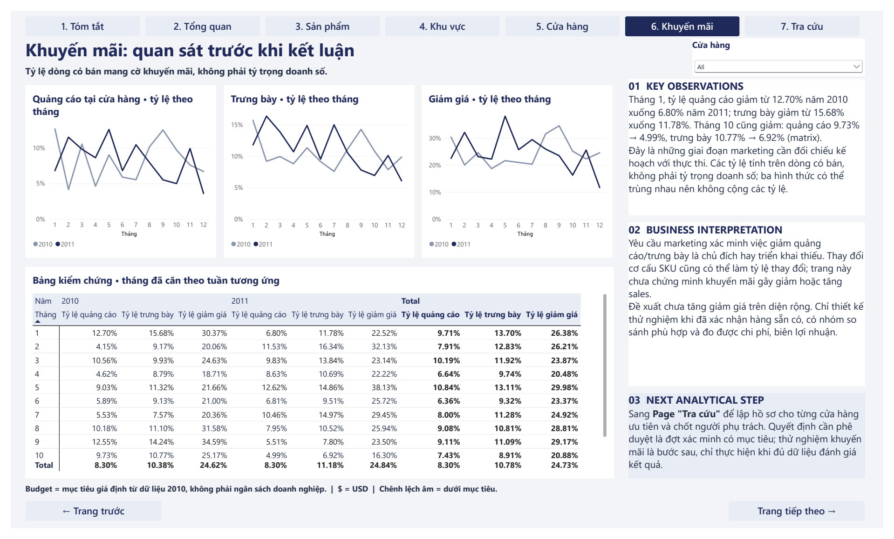
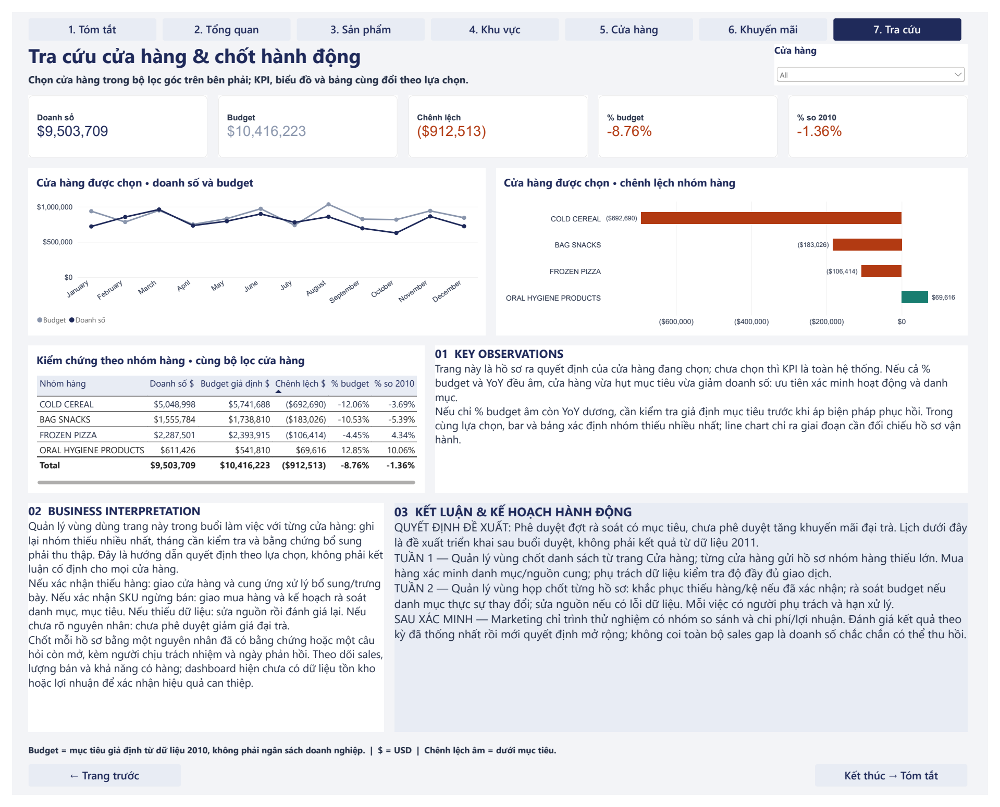

[English](README.md) | **Tiếng Việt**

# Phân tích thiếu hụt doanh số bán lẻ: Dashboard Power BI

Dự án portfolio dùng Excel, Power Query, DAX và Power BI để phân tích doanh số bán lẻ năm 2011 so với **budget mô phỏng**, giúp quản lý vùng quyết định nên kiểm tra ở đâu trước.



## Mục lục

1. [Tổng quan dự án](#1-tổng-quan-dự-án)
2. [Vấn đề và câu hỏi kinh doanh](#2-vấn-đề-và-câu-hỏi-kinh-doanh)
3. [Dữ liệu](#3-dữ-liệu)
4. [Quy trình phân tích](#4-quy-trình-phân-tích)
5. [Phương pháp xây dựng budget](#5-phương-pháp-xây-dựng-budget)
6. [Tổng quan dashboard](#6-tổng-quan-dashboard)
7. [Phát hiện chính](#7-phát-hiện-chính)
8. [Đề xuất kinh doanh](#8-đề-xuất-kinh-doanh)
9. [Triển khai kỹ thuật](#9-triển-khai-kỹ-thuật)
10. [Cấu trúc repository](#10-cấu-trúc-repository)
11. [Cách sử dụng](#11-cách-sử-dụng)
12. [Giả định và giới hạn](#12-giả-định-và-giới-hạn)
13. [Tài liệu tham khảo](#13-tài-liệu-tham-khảo)

## 1. Tổng quan dự án

| | |
|---|---|
| **Loại dự án** | Dự án portfolio cá nhân, với bối cảnh kinh doanh được xây dựng giả định |
| **Dữ liệu** | dunnhumby, Breakfast at the Frat: 524,950 dòng doanh số theo tuần, từ 2009 đến đầu 2012 |
| **Mục đích** | Tìm nơi doanh số 2011 thấp hơn mục tiêu và các vấn đề cần kiểm tra trước |
| **Công cụ** | Excel, Power Query, Power BI, DAX |
| **Ngôn ngữ dashboard** | Tiếng Việt |

## 2. Vấn đề và câu hỏi kinh doanh

Quản lý vùng cần biết nên tập trung rà soát doanh số 2011 ở đâu. Doanh số chỉ thấp hơn 2010 một chút, nhưng khoảng cách với mục tiêu lớn hơn nhiều. Vì vậy, cần phân biệt nơi thực sự giảm với nơi chỉ chưa đạt kỳ vọng.

**Câu hỏi kinh doanh:**

> Trong năm 2011, những cửa hàng và nhóm hàng nào tạo ra mức thiếu hụt doanh số so với budget, và quản lý vùng cần ưu tiên những hành động nào?

**Quyết định được hỗ trợ:**

- Rà soát nhóm hàng, bang và cửa hàng nào trước.
- Vấn đề nào chuyển cho mua hàng, cửa hàng hoặc marketing.
- Đã đủ căn cứ để tăng khuyến mãi trên diện rộng hay chưa.

## 3. Dữ liệu

| Mục | Chi tiết |
|---|---|
| **Nguồn** | [dunnhumby Source Files](https://www.dunnhumby.com/source-files/) |
| **Grain** | Sản phẩm × cửa hàng × tuần, chỉ có dòng khi có bán |
| **Thời gian** | 156 tuần, kết thúc từ 14/01/2009 đến 04/01/2012 |
| **Phạm vi** | 77 cửa hàng tại 4 bang của Mỹ, 4 nhóm hàng, 55 sản phẩm có doanh số |
| **Quy mô** | 524,950 dòng giao dịch; $27.93M doanh số; 10.29M đơn vị |

File gốc có glossary, bảng cửa hàng, bảng sản phẩm và bảng giao dịch. Bước chuẩn bị xử lý 2 mã cửa hàng trùng, bỏ một cột cửa hàng thiếu dữ liệu và thêm các cột phân tích. Số dòng giao dịch và tổng không đổi: số dòng, doanh số và số lượng khớp giữa file gốc, file Excel đã chuẩn bị và model Power BI.

`VISITS` và `HHS` không cộng được qua sản phẩm hoặc tuần, nên không measure nào dùng hai cột này.

Bản sao nguyên trạng của file gốc nằm trong [`data/raw/`](data/raw/), với thông tin nguồn ở [Tài liệu tham khảo](#13-tài-liệu-tham-khảo).

## 4. Quy trình phân tích

```text
Raw Data → Data Cleaning → Budget Construction → Data Modeling → DAX → Power BI Dashboard → Business Insights
```

1. **Dữ liệu gốc:** Kiểm tra các sheet, grain, ô trống, trùng lặp và giá trị bất thường.
2. **Làm sạch:** Làm sạch dữ liệu bằng Excel Power Query và đối soát tổng.
3. **Budget:** Xây dựng mục tiêu mô phỏng theo tuần bằng Excel Power Query.
4. **Mô hình dữ liệu:** Import các query vào Power BI, thêm cột phụ trợ, và dựng mô hình dạng sao với hai bảng fact.
5. **DAX:** 20 measure cho thiếu hụt, thay đổi so với năm trước, so sánh cửa hàng và tỷ lệ khuyến mãi.
6. **Dashboard:** 7 trang, mỗi trang có quan sát, diễn giải và bước tiếp theo.

Chi tiết (tiếng Anh): [Project Methodology](docs/Project_Methodology.md).

## 5. Phương pháp xây dựng budget

**Budget là mô phỏng, không phải ngân sách thực của dunnhumby hay doanh nghiệp.** Dữ liệu không có mục tiêu, nên budget được xây dựng để trả lời được câu hỏi về thiếu hụt.

```text
Budget (tuần 2011, cửa hàng, nhóm hàng)
  = Doanh số tuần tương ứng năm 2010, trước đó 364 ngày × (1 + mức tăng của nhóm hàng)

Mức tăng của nhóm hàng = Doanh số 2010 / Doanh số 2009 − 1, trên 51 tuần tương ứng, không tính cửa hàng 387
```

| Nhóm hàng | Mức tăng sử dụng |
|---|---:|
| BAG SNACKS | +5.74% |
| COLD CEREAL | +9.52% |
| FROZEN PIZZA | +9.20% |
| ORAL HYGIENE PRODUCTS | −2.47% |

Các tỷ lệ được làm tròn để hiển thị. Phép tính dùng giá trị chưa làm tròn, được liệt kê trong [Budget Methodology](docs/Budget_Methodology.md#growth-rate-g).

**Vì sao chọn 2010:** Đây là giai đoạn đầy đủ gần nhất trước 2011, có đủ 52 tuần và đủ 16,016 tổ hợp cửa hàng × nhóm hàng × tuần. Năm này cũng giữ được nhịp doanh số theo tuần của từng cửa hàng. Ở cấp sản phẩm, dữ liệu không đầy đủ vì chỉ có dòng khi có bán.

**Vì sao dùng 51 và 52 tuần:** Tăng trưởng dùng 51 tuần vì file chỉ có 51 tuần trong năm 2009, nên tuần kết thúc 06/01/2010 không có tuần tương ứng. Đánh giá dùng 52 tuần vì mỗi tuần 2011 đều có tuần tương ứng năm 2010.

**Cửa hàng 387:** Cửa hàng này thiếu 25 tuần năm 2009, làm tăng trưởng cao giả tạo, nên chỉ bị loại khỏi phép tính tăng trưởng. Cửa hàng vẫn nằm trong baseline 2010, budget 2011 và phần đánh giá 2011.

**Tổ hợp thiếu:** Không điền hay ước tính giá trị nào. Trong 101 tổ hợp cửa hàng × nhóm hàng × tuần bị thiếu, 100 tổ hợp là cửa hàng 387 năm 2009, đã xử lý bằng cách loại ở trên. Tổ hợp còn lại là cửa hàng 8035 trong một tuần năm 2011, được tính là thiếu hụt $12.57. Baseline 2010 không có tổ hợp thiếu.

**Giả định chính:** Mức tăng 2009–2010 tiếp diễn trong 2011; mọi cửa hàng trong một nhóm hàng có cùng mức tăng; các tuần bất thường của 2010 được chuyển sang 2011.

**Vì sao quan trọng:** Theo phương pháp này, tổng thiếu hụt là −$912,513. Nếu không giả định tăng trưởng, con số là −$130,990. Vì vậy, nên đọc kết quả budget cùng với thay đổi so với năm trước.

Budget đã được tính lại độc lập và khớp với model: 16,016 dòng, $10,416,222.58.

Chi tiết, ví dụ và kiểm chứng (tiếng Anh): [Budget Methodology](docs/Budget_Methodology.md).

## 6. Tổng quan dashboard

| Trang | Mục đích | Nội dung chính |
|---|---|---|
| **1. Tóm tắt** | Trả lời câu hỏi chính | KPI; thiếu hụt theo nhóm hàng và bang; xếp hạng cửa hàng ưu tiên |
| **2. Tổng Quan** | Phân biệt giảm thật với chưa đạt mục tiêu | Doanh số và budget theo tháng; bảng bằng chứng theo nhóm hàng |
| **3. Sản phẩm** | Tìm thay đổi theo nhà sản xuất và số lượng | Doanh số QUAKER theo tuần; thay đổi số lượng và giá; thay đổi theo nhà sản xuất |
| **4. Khu Vực** | Ưu tiên bang | Thiếu hụt theo bang; cơ cấu mức ưu tiên; ma trận bang × nhóm hàng |
| **5. Cửa hàng** | Chọn cửa hàng cần rà soát | Chênh lệch theo tháng so với toàn bộ cửa hàng; danh sách ưu tiên; cửa hàng × nhóm hàng |
| **6. Khuyến mãi** | Mô tả hoạt động khuyến mãi, không ngụ ý nhân quả | Tỷ lệ quảng cáo, trưng bày, giảm giá theo tháng |
| **7. Phụ lục: Tra cứu** | Lập hồ sơ cửa hàng và kết thúc bằng kế hoạch hành động | Bộ lọc cửa hàng; KPI; biểu đồ; kế hoạch hành động |

<details>
<summary>Xem tất cả các trang</summary>

### Tổng Quan


### Sản phẩm


### Khu Vực


### Cửa hàng


### Khuyến mãi


### Tra cứu


</details>

Ảnh được lấy từ [file PDF xuất](dashboard/Project3_Final_Dashboard.pdf) của dashboard cuối cùng.

## 7. Phát hiện chính

Mọi số liệu dưới đây đã được đối chiếu với model Power BI. Thiếu hụt là so với budget mô phỏng.

1. **Thiếu hụt lớn hơn mức giảm thực tế.** Doanh số 2011 là $9,503,709: thấp hơn budget $912,513 (−8.76%), nhưng chỉ thấp hơn 2010 là 1.36%.
2. **COLD CEREAL thiếu hụt lớn nhất,** −$692,690 (−12.06%), và giảm 3.69% so với 2010. BAG SNACKS cũng vừa thiếu hụt vừa giảm.
3. **Thiếu hụt không phải lúc nào cũng là giảm doanh số.** FROZEN PIZZA tăng 4.34% nhưng vẫn thấp hơn budget 4.45%.
4. **QUAKER giảm nhiều nhất trong các nhà sản xuất:** −$379,852 (−51.31%), doanh số tuần gần về 0 vào cuối 2011. Dữ liệu không cho biết nguyên nhân.
5. **Số lượng COLD CEREAL giảm** khoảng 9.4%, trong khi giá bình quân tăng khoảng 6.3%. Giá bình quân chịu ảnh hưởng của cơ cấu sản phẩm.
6. **Quy mô và mức độ khác nhau giữa các bang.** TX thiếu hụt nhiều tiền nhất (−$464,054). KY có tỷ lệ cao nhất (−17.11%), nhưng chỉ có 4 cửa hàng. OH thấp hơn budget $315,046 nhưng vẫn tăng 1.66%.
7. **18 trên 77 cửa hàng thỏa tiêu chí sàng lọc của dự án,** tổng cộng −$361,577. ERLANGER (−$53,178) và COVINGTON (−$40,512) lớn nhất.
8. **Hoạt động khuyến mãi thay đổi ở một số tháng.** Tỷ lệ quảng cáo giảm từ 12.70% xuống 6.80% vào tháng 1, và từ 9.73% xuống 4.99% vào tháng 10. Đây là mô tả, không cho thấy khuyến mãi làm thay đổi doanh số.

## 8. Đề xuất kinh doanh

Đây là các hành động đề xuất dựa trên phát hiện. Chúng chưa được triển khai, nên không có tác động kinh doanh nào được đo.

| Người phụ trách | Hành động đề xuất | Dựa trên |
|---|---|---|
| **Mua hàng** | Xác minh sản phẩm QUAKER còn kinh doanh không, nguồn cung có đổi không, hay dữ liệu bị thiếu. Chỉ xem lại mục tiêu nếu xác nhận thay đổi danh mục | Phát hiện 4 |
| **Quản lý vùng** | Phê duyệt đợt rà soát có mục tiêu, bắt đầu từ COLD CEREAL. TX theo quy mô tiền, KY để kiểm tra sâu | Phát hiện 2, 6 |
| **Quản lý cửa hàng** | Bắt đầu từ ERLANGER và COVINGTON, rồi đến CROWLEY và DENTON. Kiểm tra danh mục, tồn kho, giao hàng và tình trạng kệ | Phát hiện 7 |
| **Kế hoạch** | Xem lại kỳ vọng tăng trưởng ở nơi doanh số tăng nhưng thấp hơn budget, như FROZEN PIZZA và OH | Phát hiện 3, 6 |
| **Marketing** | Kiểm tra việc giảm quảng cáo và trưng bày có theo kế hoạch không. Chưa giảm giá đại trà; sau này thử nghiệm với nhóm so sánh và dữ liệu chi phí, biên lợi nhuận | Phát hiện 8 |

## 9. Triển khai kỹ thuật

| Công cụ | Vai trò thực tế |
|---|---|
| **Excel và Power Query** | Kiểm tra dữ liệu, làm sạch, nối bảng, nhóm dữ liệu, tính tăng trưởng, budget mô phỏng và bảng dimension |
| **Power Query trong Power BI** | Import các query từ Excel và thêm `Is_Discount`, `Thang_So_Sanh`, `Muc_Uu_Tien` |
| **Power BI** | Mô hình dữ liệu, dashboard 7 trang, điều hướng và bộ lọc |
| **DAX** | 20 measure, dùng `SUM`, `AVERAGE`, `DIVIDE`, `CALCULATE` và `ALL` |

**Mô hình:**

```text
Dim_Category → Dim_Product → Fact_Transactions ← Dim_Store, Dim_Date
Dim_Category, Dim_Store, Dim_Date → Budget
```

Chi tiết (tiếng Anh): [DAX Measures](docs/DAX_Measures.md).

## 10. Cấu trúc repository

```text
.
├── README.md                     README tiếng Anh
├── README.vi.md                  README tiếng Việt
├── .gitignore
├── assets/screenshots/           Ảnh 7 trang dashboard
├── dashboard/
│   ├── Project3_Final_Dashboard.pbix
│   └── Project3_Final_Dashboard.pdf
├── data/raw/
│   └── dunnhumby - Breakfast at the Frat.xlsx
├── docs/
│   ├── Project_Methodology.md
│   ├── Budget_Methodology.md
│   ├── DAX_Measures.md
│   └── Power_Query_M.md
```

## 11. Cách sử dụng

**Để xem kết quả:** Mở [file PDF](dashboard/Project3_Final_Dashboard.pdf) hoặc các ảnh ở trên. Không cần cài phần mềm.

**Để tương tác với dashboard:** Cài Power BI Desktop trên Windows và mở [`dashboard/Project3_Final_Dashboard.pbix`](dashboard/Project3_Final_Dashboard.pbix). File được kiểm tra trên phiên bản 2.159. Dữ liệu đã lưu sẵn trong file, nên không cần refresh.

**Để refresh dữ liệu:**

1. Trong Power BI Desktop, vào **Home → Transform data → Data source settings**.
2. Chọn nguồn workbook, chọn **Change Source**, rồi trỏ tới `data/raw/dunnhumby - Breakfast at the Frat.xlsx` trong bản sao repository của bạn.
3. Chọn **Close**, rồi **Refresh**. Lần chạy thử mất khoảng một phút.

Danh sách nguồn có thể rút gọn đường dẫn dài bằng dấu `...`. Để xem đường dẫn đầy đủ, chọn lại **Change Source**.

## 12. Giả định và giới hạn

- **Budget là mô phỏng.** Thiếu hụt là so với giả định của dự án, không phải mục tiêu thực.
- **Bối cảnh được xây dựng giả định.** Không có khách hàng hay stakeholder thực.
- **Dữ liệu là lịch sử và là mẫu.** "Hệ thống" trên dashboard là 77 cửa hàng này, không phải toàn bộ chuỗi.
- **Kết quả khuyến mãi chỉ mang tính mô tả.** Các hình thức trùng lẫn với giảm giá, và tỷ lệ tính trên dòng có bán, không phải doanh thu. Dự án không khẳng định tác động nhân quả.
- **Chỉ có dòng khi có bán.** Không phân biệt được hết hàng với không có nhu cầu.
- **Không có dữ liệu chi phí, biên lợi nhuận, tồn kho hay đối thủ.** Không xác định được nguyên nhân và lợi nhuận.
- **Tiêu chí ưu tiên là giả định của dự án.** Các mức 10 điểm, 2 tháng và 6 tháng được đặt sau khi xem kết quả 2011, được ghi cứng, và thay đổi một phần nếu bỏ QUAKER.
- **Mẫu nhỏ.** KY có 4 cửa hàng, IN có 1.
- **Nhận xét là chữ tĩnh.** Nội dung mô tả trạng thái chưa lọc, và không đổi theo bộ lọc.

## 13. Tài liệu tham khảo

- [dunnhumby Source Files](https://www.dunnhumby.com/source-files/): Breakfast at the Frat, nguồn dữ liệu. Mọi quyền đối với dữ liệu thuộc về dunnhumby. Xem [Điều khoản của dunnhumby](https://www.dunnhumby.com/terms-and-conditions/). Dữ liệu được đưa vào nguyên trạng cho mục đích portfolio phi thương mại, và không thuộc phạm vi bất kỳ giấy phép nào của repository này. Dữ liệu sẽ được gỡ khi dunnhumby yêu cầu.
- [Tài liệu Microsoft Power BI](https://learn.microsoft.com/power-bi/)
